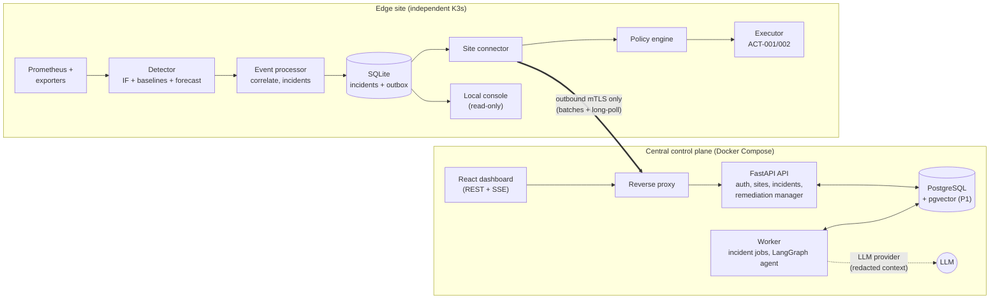
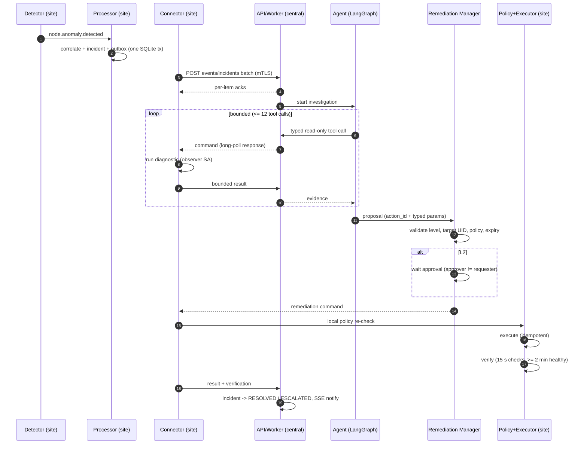
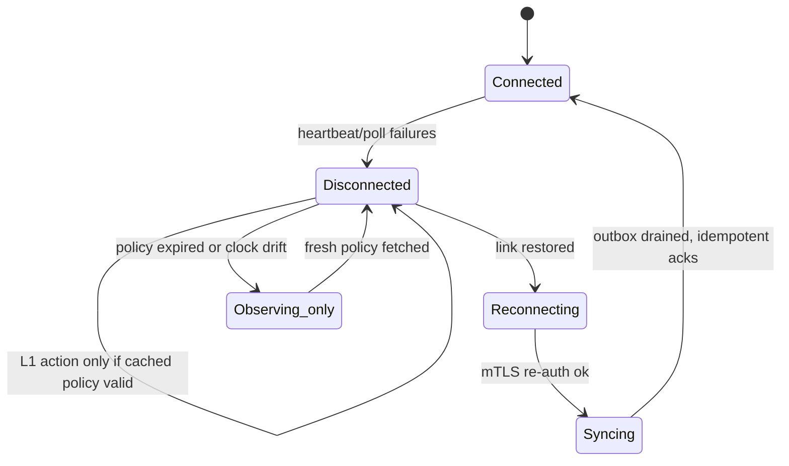
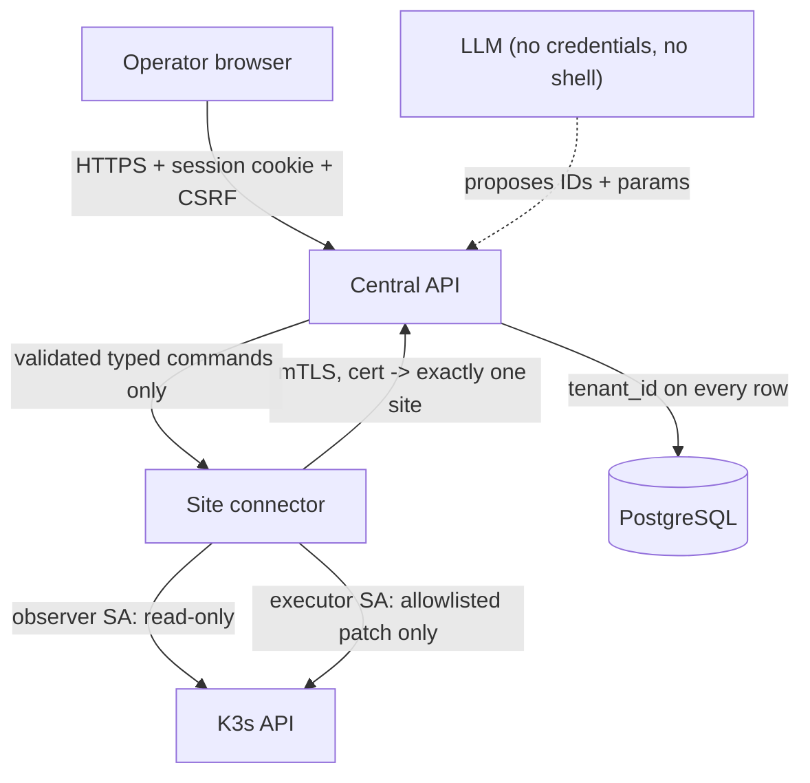

# Architecture

Renders on GitHub and in most Markdown viewers (Mermaid). Keep diagrams updated when the contract changes.

## 1. Components

Direction rule: every arrow between sites and central is **initiated by the site**. Central never dials in.

## 2. Incident-to-recovery sequence

## 3. Offline autonomy (Scenario B)

In `Observing_only`, detection and incident persistence continue; automatic remediation is disabled (fail closed). L2 operations wait; connectivity loss never upgrades L2 to L1.

## 4. Trust boundaries

## 5. Repository map

| Path | Content |
|---|---|
| `src/aiops/contracts` | Pydantic models mirroring `contracts/schemas` |
| `src/aiops/common` | shared utilities (time, ids, redaction, logging) |
| `src/aiops/central/{api,worker,agent,remediation,db}` | central code |
| `src/aiops/edge/{detector,processor,connector,policy,executor,console_api}` | edge code |
| `web/` | React dashboard and local console page |
| `deploy/` | Compose, Helm `edge-stack`, QEMU lab |
| `experiments/` | fault library, harness, analysis, run metadata |
| `contracts/` | JSON schemas, examples, action catalogue, sample policy, autonomy matrix |
| `prompts/` | agent prompts and injection test payloads |
| `tests/` | unit, integration, security, e2e |
